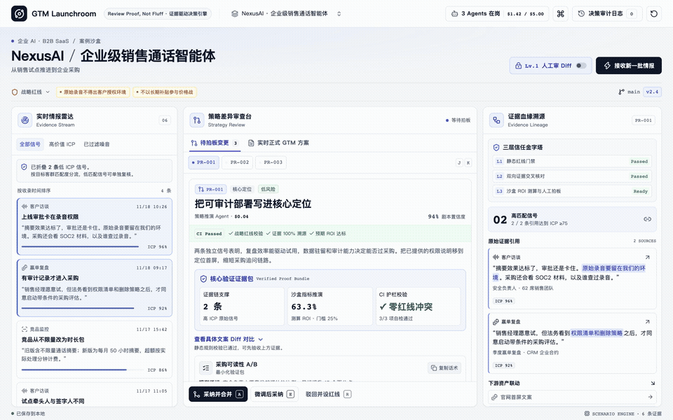

# GTM Launchroom

[打开在线工作台](https://gtm-launchroom.vercel.app/) · [下载 30 秒录屏](media/portfolio-walkthrough.mp4)

## 项目定位

GTM Launchroom 是一个**供管理层使用的上市策略治理与审查工作台**。它把分散的客户访谈、赢单复盘、竞品变化与渠道信号组织成可审计的策略变更。团队先判断信号是否匹配目标客户，再检查文案变动、证据来源、战略限制与收益假设，最后决定采纳、微调或驳回。策略版本、原始证据和审查决定可以互相追溯。

## 工作台与功能

| 模块 | 可操作能力 |
|---|---|
| 商业剧本与上下文 | 在 NexusAI 企业级销售通话智能体、Lumina 北美智能家居出海与 Apex 制造业供应链数字化三个场景间切换。每个场景有独立的信号集、待审提案、战略红线和正式方案。 |
| 实时情报雷达 | 浏览客户访谈、复盘和竞品信号，按全部、高价值 ICP 和已过滤噪音筛选。低匹配信号默认折叠，展开后仍可核对。可接收一批新情报，观察提案与任务状态变化。 |
| 策略变更队列 | 用类似 Pull Request 的方式审查定位、客群、计费等变更。可切换待拍板队列与实时正式方案，查看当前策略版本。支持键盘切换提案。 |
| 文案 Diff 与验证包 | 展开现行文案和拟议文本的红绿对比。核心证据包集中显示来源、核查结果和沙盒收益。部分提案附带 A/B 验证步骤、观测指标和可复制话术。 |
| 分层门禁 | L1 比对战略红线，L2 核查证据引用，L3 对照沙盒 ROI 门槛与人工决定。规则、证据及测算状态分别展示。 |
| 证据血缘 | 从提案跳回左栏的原始信号，从信号查看它关联的审查上下文。右栏显示引文、来源、ICP 匹配度和下游资产，例如官网首屏、采购交接简报与安全 FAQ。 |
| 决策与版本管理 | 支持采纳合并、编辑后采纳、驳回并记录红线。可切换人工审查与规则限定的自动合并流程，查看正式方案版本及决策审计日志。 |
| 运行状态与恢复 | 可查看场景中的 Agent 任务、预算和进度。工作台支持保存场景状态、恢复基线与查看快捷键。 |

## 一条完整的审查路径

以 NexusAI 的「把可审计部署写进核心定位」为例，先在雷达筛选高价值信号，再从右侧证据链定位录音权限和采购合规原话。展开策略文案 Diff，核对红线、证据与 ROI 门槛后采纳。最后到正式方案和审计日志核对版本与决定记录。

## Lumina｜北美智能家居策略审查

**North America Community Signals (r/homeautomation & r/privacy)** 收录 8 条任务提供的社区信号。每条记录保留原文、社区标签、ICP 匹配度、置信度和入队状态。隐私风险及置信度低于 0.80 的信号标为人工复核，低匹配信号进入单独队列。社区标签按输入保留，原帖链接未随输入提供。

| 提案 | 信号 | 执行资产 |
|---|---|---|
| 首屏文案与影像归属 | SIG-NA-01、02、05 | 旧版与新版文案 Diff、落地页 CVR 和加购率 A/B 方案、CTA。 |
| YouTube / Reddit 创作者对比 | SIG-NA-02、04 | 英文邀约邮件、视频开场、延迟测量方案和 UTM 实验设计。 |
| 售前安全与隐私 FAQ | SIG-NA-03、06 | 独立 FAQ 文案 Diff、CTR/CVR 验证方案及法律审查简报。L1 阻止直接合并。 |

从右侧证据血缘可跳到提案引用的情报原文。ROI 卡片按剧本中的收益和成本假设计算。涉及加密、订阅费用、时延或隐私架构的文案，按执行清单核验后再对外发布。
