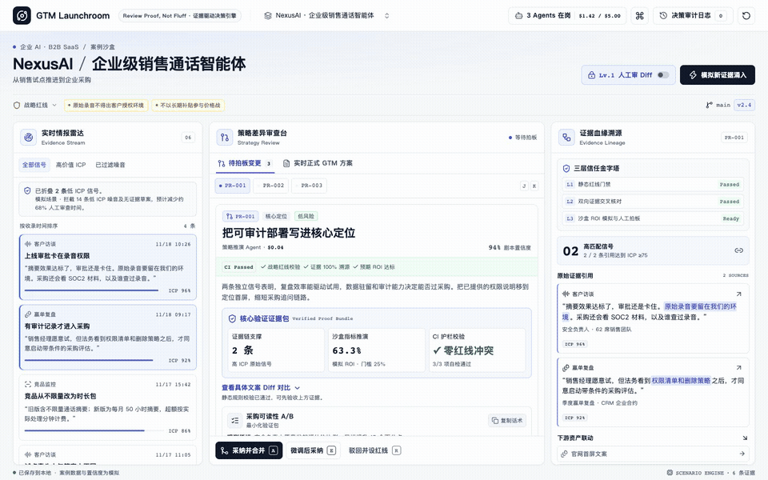

# GTM Launchroom

[打开工作台](https://chengtaoxu23-prog.github.io/gtm-launchroom/) · [播放 30 秒视频](https://chengtaoxu23-prog.github.io/gtm-launchroom/media/) · [下载 MP4](media/workbench.mp4)

## 项目定位

GTM Launchroom 是一个**证据驱动的上市策略审查工作台**。它把分散的客户访谈、赢单复盘、竞品变化与渠道信号组织成可审计的策略变更。团队先判断信号是否匹配目标客户，再检查文案变动、证据来源、战略限制与收益假设，最后决定采纳、微调或驳回。策略版本、原始证据和审查决定可以互相追溯。

## 工作台与功能

| 模块 | 可操作能力 |
|---|---|
| 商业剧本与上下文 | 在 NexusAI 企业级销售通话智能体、Lumina 北美智能家居出海与 Apex 制造业供应链数字化三个场景间切换。每个场景有独立的信号集、待审提案、战略红线和正式方案。 |
| 实时情报雷达 | 浏览客户访谈、复盘和竞品信号，按全部、高价值 ICP 和已过滤噪音筛选。低匹配信号默认折叠，展开后仍可核对。可触发一批模拟新信号，观察提案与任务状态变化。 |
| 策略变更队列 | 用类似 Pull Request 的方式审查定位、客群、计费等变更。可切换待拍板队列与实时正式方案，查看当前策略版本。支持键盘切换提案。 |
| 文案 Diff 与验证包 | 展开现行文案和拟议文本的红绿对比。核心证据包集中显示来源、核查结果和沙盒收益。部分提案附带 A/B 验证步骤、观测指标和可复制话术。 |
| 分层门禁 | L1 比对战略红线，L2 核查证据引用，L3 对照沙盒 ROI 门槛与人工决定。规则、证据及测算状态分别展示。 |
| 证据血缘 | 从提案跳回左栏的原始信号，从信号查看它关联的审查上下文。右栏显示引文、来源、ICP 匹配度和下游资产，例如官网首屏、采购交接简报与安全 FAQ。 |
| 决策与版本管理 | 支持采纳合并、编辑后采纳、驳回并记录红线。可切换人工审查与规则限定的自动合并流程，查看正式方案版本及决策审计日志。 |
| 运行状态与恢复 | 可查看场景中的 Agent 任务、预算和进度。工作台在当前浏览器保存场景状态，支持重置样例与查看快捷键。 |

## 一条完整的审查路径

以 NexusAI 的「把可审计部署写进核心定位」为例，先在雷达筛选高价值信号，再从右侧证据链定位录音权限和采购合规原话。展开策略文案 Diff，核对红线、证据与 ROI 门槛后采纳。最后到正式方案和审计日志核对版本与决定记录。

这是即开即用的浏览器工作台。内置商业案例、置信度、预算、Agent 状态和 ROI 为合成或模拟数据。界面操作与决策记录在浏览器内生效。
